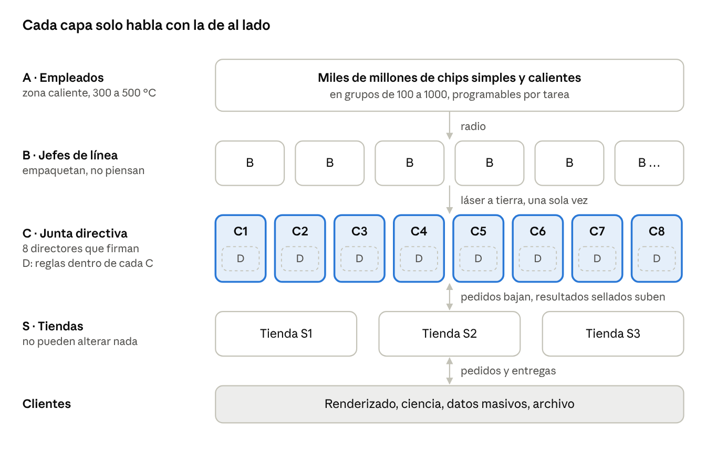

# Proyecto Enjambre ABCDS

**Autor:** Santiago González · **Fecha de la idea:** 18 de octubre de 2026

**Registro público en Zenodo:** [10.5281/zenodo.23448232](https://doi.org/10.5281/zenodo.23448232) (versión 1) · todas las versiones: [10.5281/zenodo.23448231](https://doi.org/10.5281/zenodo.23448231)

Diseño conceptual de un centro de datos espacial hecho de muchísimos chips simples y resistentes al calor, repartidos en un área enorme y organizados como una empresa.

La idea central es hacer lo contrario a la industria: en vez de meter chips muy potentes en poco espacio y luchar para enfriarlos, usar chips más débiles que aguantan calor, separados unos de otros, para que cada uno se enfríe solo irradiando al espacio.

📄 **Documento completo:** [Proyecto-Enjambre-ABCDS.pdf](Proyecto-Enjambre-ABCDS.pdf)

## Las cinco capas

| Capa | Puesto en la empresa | Qué hace |
| --- | --- | --- |
| **A** | Empleados | Chips simples y resistentes al calor, en grupos de 100 a 1000 con composición fija y programable |
| **B** | Jefes de línea | Empaquetan lo de sus A en una caja con esquema fijo, marcan huecos y la envían. Nada más |
| **C** | Junta directiva | 8 directores especializados por función. Reciben todo, verifican, firman resultados y aguantan hasta 2 hackeados |
| **D** | Estatutos | Reglamento interno de cada C, aislado de los demás, actualizado a mano solo en emergencias |
| **S** | Tiendas | Reciben pedidos y entregan resultados sellados. Pueden empaquetar, pero no modificar |

## Ideas clave

- **Repartir en vez de concentrar:** en el espacio sobra lugar, así que la densidad de calor baja.
- **Zonas a distintas temperaturas:** solo A trabaja caliente; B, C y S usan electrónica normal en la sombra o en tierra.
- **Espejo:** da sombra y redirige la luz a los paneles solares con una sola pieza.
- **Compartimentar:** una falla o un ataque se queda donde empezó.
- **Versión mejorada:** A trabajando a unos 125 °C con silicio de grado automotriz e industrial, en lugar de 500 °C.

## Estado

Concepto publicado como registro de autoría. El documento incluye números aproximados, problemas abiertos y una comparación con trabajos previos (Google Project Suncatcher, Starcloud, SpaceX, LEACH, entre otros).

## Licencia y citas

© 2026 Santiago González. Licencia [Creative Commons Attribution Non Commercial No Derivatives 4.0 International](https://creativecommons.org/licenses/by-nc-nd/4.0/): puedes leer, compartir y citar este trabajo dando crédito al autor, sin uso comercial ni modificaciones.

**Cómo citarlo:**

> González, S. (2026). *Proyecto Enjambre ABCDS: diseño de un centro de datos espacial distribuido con chips resistentes al calor*. Zenodo. https://doi.org/10.5281/zenodo.23448232
